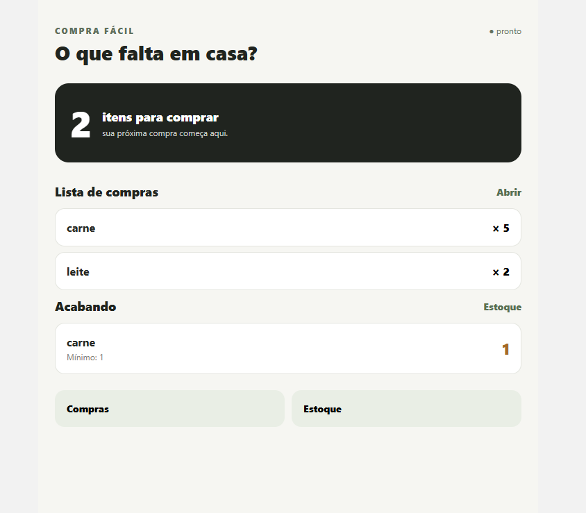
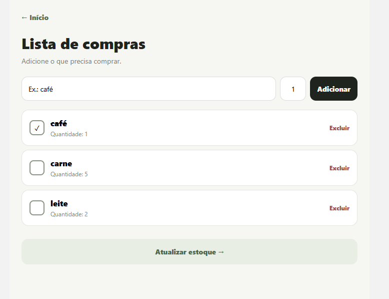
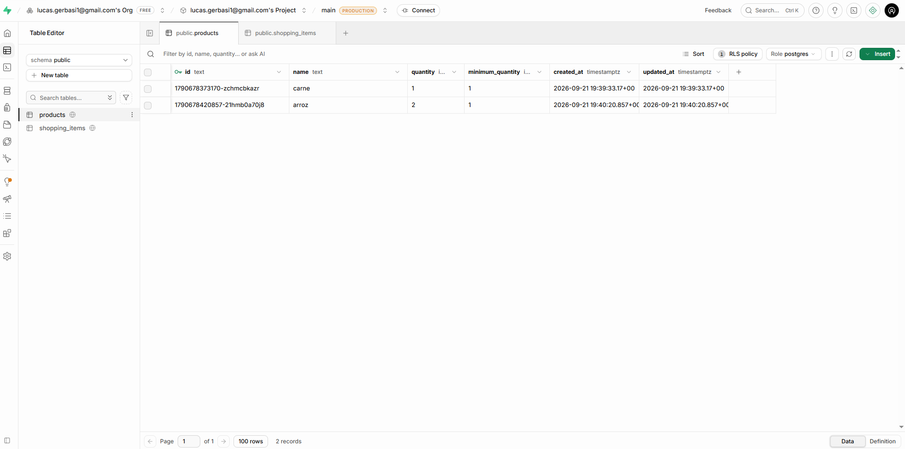
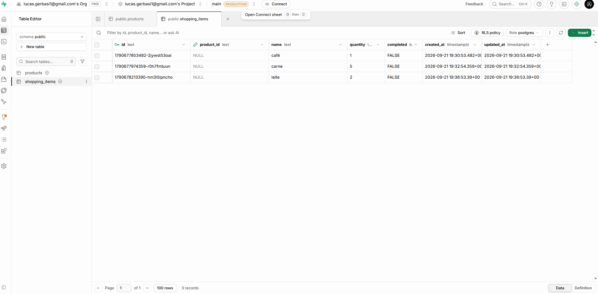

# Compra Fácil

**Problema:** Pessoas esquecem produtos durante as compras, compram itens que já possuem ou percebem tarde demais que algo está acabando.

**Solução:** Uma lista de compras ligada a um estoque doméstico simples. O usuário adiciona o que precisa, marca o que comprou e ajusta a quantidade que tem em casa.

**React Native + Expo:** Expo Router fornece navegação entre Início, Compras, Estoque e cadastro.

**Expo SQLite:** No Android/iOS, `expo-sqlite` cria e persiste as tabelas `products` e `shopping_items`. No web existe uma implementação local equivalente para permitir desenvolvimento no navegador.

**Supabase/PostgreSQL:** `supabase/schema.sql` cria as mesmas entidades no PostgreSQL e o app faz upsert dos dados locais quando as credenciais estão configuradas.

## Telas e Banco de Dados

**Tela Inicial (Dashboard e Alertas):**

**Lista de Compras (Adicionando itens):**

**Persistência Online (Supabase - Tabela products):**

**Persistência Online (Supabase - Tabela shopping_items):**

## Bimestre 2: leitura de cupom fiscal com OCR

A tela **Ler cupom fiscal** está disponível na página inicial.

1. No Android/iOS, fotografe um cupom ou escolha uma imagem.
2. O OCR nativo tenta extrair o texto do cupom usando Google ML Kit (Android) ou Apple Vision (iOS).
3. O app prepara uma lista de possíveis produtos. O usuário pode corrigir nomes, alterar quantidades e desmarcar itens que não devem entrar no estoque.
4. Só depois da confirmação o app soma as quantidades aos produtos existentes ou cria novos produtos. As alterações passam pelo mesmo fluxo de persistência local e sincronização Supabase do app.

**Importante sobre a plataforma:** `expo-text-extractor` contém código nativo e não está incluído no Expo Go padrão. Para testar OCR real em Android, é necessário gerar um development build/compilar o app com o módulo nativo. No navegador, a leitura automática usa Tesseract.js com o idioma português. Na primeira utilização, o navegador precisa de internet para baixar o modelo de idioma; a primeira leitura pode demorar. Se a leitura não ficar boa, o texto extraído continua editável e pode ser corrigido antes de preparar os produtos. A seleção de imagens usa `expo-image-picker`.

## Instalação e execução

1. Instale a versão de Node.js exigida pelo SDK Expo utilizado no projeto.
2. Na pasta do projeto, execute `npm install`.
3. Configure `.env` com `EXPO_PUBLIC_SUPABASE_URL` e `EXPO_PUBLIC_SUPABASE_PUBLISHABLE_KEY` para sincronização online.
4. Para interface no navegador: `npm run web`.
5. Para reconhecimento OCR nativo em Android, instale Android Studio e configure o SDK Android; depois execute `npx expo run:android`. O primeiro build pode demorar. O dispositivo/emulador precisa ter os requisitos de desenvolvimento Android configurados.

Não compartilhe o arquivo `.env` nem publique chaves secretas do Supabase. Use apenas a chave publishable no aplicativo cliente.

### Receipt product filtering

After OCR, the receipt screen now filters common non-product lines such as addresses, dates/times, server and table details, check/guest counts, payment/card details, tips, taxes, and totals. It removes trailing prices from likely item descriptions and deduplicates repeated lines. Product suggestions remain editable and must be reviewed before they update inventory. OCR is imperfect, so ambiguous lines may still require manual correction.
